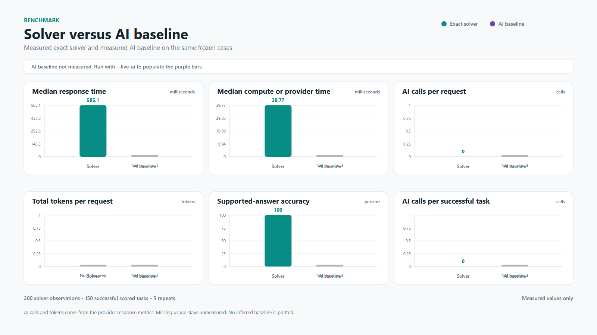
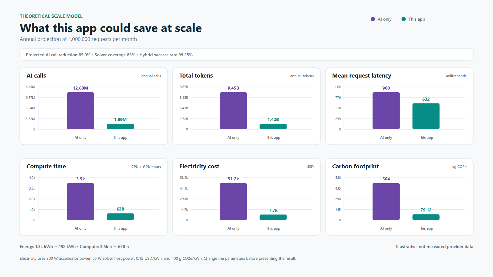

# Model Router

Model Router is a chat-style math application that decides how each request should be handled. It solves supported calculus and algebra with SymPy, sends language work to an optional AI provider, and can ask Jev to choose the least expensive safe route.

The exact solver is the default path for supported math. It validates the request, calculates a result, checks that result, and reports the route and call counts. A general model is not required for exact math.

## What the project does

Model Router supports four structured operations:

- Derivatives
- Indefinite and definite integrals
- Limits
- Real roots of polynomial equations

The chat interface also recognizes a small set of natural-language forms, such as `find the derivative of x^2` and `integrate x from 0 to 1`. The parser converts only known forms into structured math. Unknown messages stay at the language-model boundary and never become executable SymPy input.

For every request, the application records the route, result status, checks, timing, model calls, and provider usage when the provider reports it. A valid request can return `unresolved` when it falls outside the safe math boundary or reaches a time limit. AI explanations and AI answers remain unverified.

## Why route requests before using a large model?

A general language model can generate a full answer, but it is wasteful to use one for every request. Many requests have a smaller, safer answer path. A derivative such as `x^2` can go to SymPy. A request for a written explanation can go to a language model. An unsafe or unsupported request can be refused.

A decision classifier handles that choice. It reads the request and returns a small label such as `solver`, `ai`, or `refuse`. It does not generate the final answer. Because its output space is small, a decision classifier can be much smaller and use much less compute than a model that writes a complete response.

Routing can reduce expensive answer-generation calls when it sends structured math to the exact solver. The exact solver uses zero general-model calls for that work. Jev adds one routing call when the Jev mode is enabled, so the total benefit depends on how many larger model calls the decision avoids. The benchmark must measure that trade-off for the target workload.

## What Jev does

Jev is the optional server-side decision model in this project. The application gives Jev a bounded request and a typed routing question. Jev returns one of these choices:

- `solver`: use the exact SymPy route for a validated structured request.
- `ai`: use the configured AI provider for language work or generation.
- `refuse`: stop when the request is unsafe, malformed, or outside the allowed input size.

Jev chooses a route. It does not calculate the math and it cannot edit an exact result. If Jev is unavailable, times out, or returns malformed data, the server records the failed attempt and uses the deterministic fallback. A refusal remains visible in the response instead of silently becoming an AI request.

## How a request moves through the application

```text
Browser
|
+-- POST /api/chat
|   +-- Parse a supported free-form math phrase
|   +-- Validate any extracted request with the normal schema and grammar
|   `-- Keep unknown text as a language prompt
|
+-- POST /api/route
|   +-- Accept one structured request or one bounded prompt
|   +-- deterministic
|   |   +-- Structured math -> exact SymPy solver
|   |   `-- Language prompt -> configured AI provider
|   +-- jev
|   |   +-- Jev classifier -> solver, ai, or refuse
|   |   +-- Jev failure -> deterministic fallback
|   |   +-- solver -> exact SymPy result
|   |   +-- ai -> configured AI provider
|   |   `-- refuse -> explicit refusal with route evidence
|   `-- ai_only -> configured AI provider
|
`-- POST /api/solve
    +-- Validate the structured request
    +-- Run the bounded SymPy worker
    `-- Return the result, checks, steps, and metrics
```

The route response keeps routing evidence separate from the answer. You can see the selected route, Jev attempts, provider names, model calls, tokens, timing, and fallback reason without treating routing metadata as mathematical proof.

## Repository map

```text
Model-Router/
|-- app/
|   |-- main.py       # FastAPI endpoints and request validation
|   |-- chat.py       # Conservative free-form math extraction
|   |-- solver.py     # Bounded SymPy calculations and checks
|   |-- router.py     # Jev and deterministic route selection
|   `-- ai.py         # Hosted and local AI provider adapters
|-- web/
|   |-- index.html    # Chat interface and route selector
|   `-- app.js        # Browser requests and route evidence
|-- benchmarks/
|   |-- cases.json    # 40 frozen cases, ten per operation
|   |-- run_benchmark.py
|   |-- route_benchmark.py
|   `-- theoretical_savings.py
|-- tests/            # API, router, benchmark, and browser contract tests
`-- docs/
    |-- routing-spec.md
    |-- evaluation.md
    `-- evidence/
        |-- solver-five-runs.json
        |-- theoretical-savings.json
        `-- benchmark images and evidence notes
```

## Latest benchmark results

### Measured exact-route result

The latest measured report ran the public HTTP API five times over the frozen 40-case fixture. It produced 200 observations on one Uvicorn process with no provider configured.

| Metric | Result | Source in the report |
| --- | ---: | --- |
| Supported-answer accuracy | 150/150, 100% | `summary.solver.passed` and `scored_observations` |
| Boundary handling | 50/50 passed | `summary.solver.boundary_passed` and `boundary_observations` |
| Recorded model calls | 0 across 200 observations | `summary.solver.model_calls.known_total` |
| End-to-end latency | 585.121 ms p50, 515.202 to 1,278.825 ms | `summary.solver.latency_ms` |
| Solver worker time | 39.772 ms p50 | `summary.solver.solver_ms.median` |
| Known solver work | 7,693.593 ms across scored solved observations | `summary.solver.solver_ms.known_total` |

The 150 scored observations are the 30 supported solved cases repeated five times. The remaining 50 observations cover unresolved, rejected, and safely bounded inputs. This proves exact-route behavior on the frozen fixture. It does not prove AI quality, provider latency, provider energy, or provider cost because the report contains no live AI baseline.

- [Raw measured report](docs/evidence/solver-five-runs.json)
- [Measured benchmark dashboard](docs/evidence/measured-benchmark.html)
- [Measured benchmark slide](docs/evidence/compute-benchmark-slide.svg)



The dashboard leaves the AI baseline empty because no live provider report was supplied. Missing provider tokens are unknown, not zero.

### Scenario projection at one million requests per month

The scale model compares two scenarios over twelve months:

1. **AI only.** Every request goes to a model.
2. **This app hybrid.** The exact solver handles 85% of requests. The remaining 15% goes to a model.

The 85% coverage value comes from the measured fixture. The exact route handled 170 of 200 observations without a provider call. Traffic, model behavior, energy, pricing, and carbon values are scenario inputs.

| Annual metric | AI only | This app hybrid | Difference | Reduction |
| --- | ---: | ---: | ---: | ---: |
| AI calls | 12,600,000 | 1,890,000 | 10,710,000 | 85.00% |
| Total tokens | 9,450,000,000 | 1,417,500,000 | 8,032,500,000 | 85.00% |
| Mean request latency | 900 ms | 632.353 ms | 267.647 ms | 29.74% |
| Compute work proxy | 3,500 h | 637.687 h | 2,862.313 h | 81.78% |
| Energy | 1,260 kWh | 197.790 kWh | 1,062.210 kWh | 84.30% |
| Token plus electricity cost | $51,181.20 | $7,678.23 | $43,502.97 | 85.00% |
| Carbon estimate | 504 kg CO2e | 79.116 kg CO2e | 424.884 kg CO2e | 84.30% |
| Success rate | 95.00% | 99.25% | 4.25 points | n/a |

These values are calculated projections. They are not measurements from an AI provider. The compute row adds solver CPU hours and model GPU hours as a directional work proxy. CPU hours and GPU hours are different resources, so that sum is not a physical hardware-equivalent unit.

- [Theoretical savings report](docs/evidence/theoretical-savings.json)
- [Assumptions and calculation steps](docs/evidence/theoretical-savings-explanation.md)
- [Evidence note with source fields](docs/evidence/theoretical-savings-evidence.md)
- [Theoretical savings slide](docs/evidence/theoretical-savings.svg)



The chart is illustrative. It uses assumed model latency, retries, token counts, accelerator power, PUE, prices, electricity, and carbon intensity.

## Assumptions and evidence

| Input | Value | Type | Evidence or limitation |
| --- | ---: | --- | --- |
| Monthly traffic | 1,000,000 requests | Scenario assumption | A presentation scale. It is not production traffic telemetry. |
| Projection period | 12 months | Scenario assumption | Converts monthly values to annual values. |
| Solver coverage | 85% | Measured fixture input | 170 of 200 observations used the exact route without a provider call. |
| Solver success rate | 100% | Measured fixture input | 150 of 150 scored solved observations passed. |
| Solver wall time | 585.121 ms p50 | Measured fixture input | Five repeats on the public HTTP route. |
| Solver worker time | 39.772 ms p50 | Measured fixture input | Reported separately from end-to-end HTTP time. |
| Model latency | 900 ms | Scenario assumption | One response before queueing. No live model baseline was measured. |
| Retry rate | 5% | Scenario assumption | Adds an average 0.05 model calls per model-routed request. |
| Model success rate | 95% | Scenario assumption | A selected quality floor for the projection. |
| Tokens per model call | 600 input plus 150 output | Scenario assumption | 750 tokens per call. Provider usage is absent from the exact-route report. |
| Model compute | 1 GPU-second at 300 W | Scenario assumption | A simple accelerator work unit, not provider telemetry. |
| Solver host power | 65 W | Scenario assumption | Approximate local CPU power for the projection. |
| PUE | 1.2 | Scenario assumption | Multiplies device energy by data-center overhead. |
| Prices | $0.003 input and $0.015 output per 1,000 tokens | Scenario assumption | Pricing knobs. Provider billing was not measured. |
| Electricity and carbon | $0.12 per kWh and 400 g CO2e per kWh | Scenario assumption | Illustrative conversion inputs. |

The benchmark environment was Python 3.14.7 on a 12th Gen Intel Core i5-12400F with 6 physical and 12 logical processors. The run used one Uvicorn process, no reload, no provider credentials, and no concurrent test suite. Background desktop activity remained, so the timings are local observations rather than controlled hardware benchmarks. The raw report stores the fixture SHA-256 and source commit for provenance.

The evidence files keep measured values separate from assumptions. The raw JSON report contains the run fields. The evidence note maps each headline number to its source field. The explanation note shows the calculation order and states what the model does not include, such as queueing, batching, caching, network transfer, provider warm-up, and workload changes.

## How to expand the project

- Add route labels for retrieval, code execution, vision, or specialist math tools.
- Add confidence thresholds and a safe fallback policy for low-confidence Jev decisions.
- Train or deploy a local decision classifier for private, low-latency routing.
- Cache route decisions for repeated request shapes while keeping user data out of shared keys.
- Add a larger workload mix with natural-language prompts, exact math, and unsupported requests.
- Add a manual rubric for explanation quality alongside the machine-readable answer score.
- Add dashboards for route choice, avoided general-model calls, latency, and provider cost.
- Add model and prompt version fields so benchmark results remain reproducible.

## Limits and interpretation

The exact route is authoritative only within its documented math boundary. Numerical samples are evidence, not a universal proof. AI answers and explanations are unverified. Jev selects a route and does not establish mathematical truth.

The measured report records exact-route calls and local timing. It does not measure provider tokens, provider energy, provider cost, or total cloud compute. The scenario projection estimates those values from explicit assumptions. Do not present it as a live provider benchmark.

The visual editor is a presentation layer. It converts MathQuill input into the same bounded structured grammar used by the solver and never sends raw LaTeX to the API. MathQuill is included under the Mozilla Public License. See `web/assets/LICENSES.txt` for third-party notices.

Read [the evaluation guide](docs/evaluation.md), [the routing specification](docs/routing-spec.md), and [the measurement plan](docs/evidence/measurement-plan.md) for the detailed contracts and limits.

## Run it locally

Python 3.14 is the tested runtime. Node.js is used for JavaScript syntax and frontend behavior checks.

```powershell
python -m venv .venv
.\.venv\Scripts\python.exe -m pip install -c requirements.lock -r requirements-dev.txt
.\.venv\Scripts\python.exe -m uvicorn app.main:app --host 127.0.0.1 --port 8000
```

Open [Model Router locally](http://127.0.0.1:8000). Write a question in the chat composer and submit it. You can enter a formula such as `x^3*sin(x)` or a supported phrase such as `find the derivative of x^2`. The visual editor supports fractions, exponents, roots, trigonometric functions, and symbols. Typed input uses explicit multiplication such as `2*x`.

The route selector offers the exact solver, deterministic routing, Jev routing, and AI-only comparison. Exact math works without provider configuration.

## Configure optional AI and Jev providers

For a hosted OpenAI-compatible provider, set `AI_BASE_URL`, `AI_MODEL`, and `AI_API_KEY`. The adapter appends `/chat/completions` to the base URL.

For a local Ollama provider, set the provider and model:

```powershell
$env:AI_PROVIDER = "ollama"
$env:OLLAMA_MODEL = "qwen3.5:4b"
$env:OLLAMA_BASE_URL = "http://127.0.0.1:11434"
$env:OLLAMA_TIMEOUT_SECONDS = "120"
.\.venv\Scripts\python.exe -m uvicorn app.main:app --host 127.0.0.1 --port 8000
```

For Jev routing, set `TYPESAFE_API_KEY`. You can also set `JEV_BASE_URL`, `JEV_MODEL`, and `JEV_TIMEOUT_SECONDS`. The Jev route is optional. If it is not configured, the server uses the deterministic route and reports that fallback.

Keep `.env` and all provider keys out of Git. See [provider research](docs/research/provider.md) and [the deployment guide](docs/deploy.md) for provider limits and deployment details.

## Check the project

Run the local verification gate before merging:

```powershell
.\.venv\Scripts\python.exe scripts/check.py
```

The gate runs public API tests, router tests, JavaScript checks, frontend behavior tests, and real HTTP checks against the 40 frozen math cases. Provider contract tests use fake transports and do not make paid calls.
