# Local delivery validation

## Scope and evidence

The implementation is a working local website, not the earlier static visual prototype. It covers structured single-variable derivatives, integrals, limits, and bounded polynomial equations. The default solve route never requests an explanation or model fallback automatically.

The user approved the layout and public API and browser test boundaries before implementation. Local checks precede direct merges. No PRs or GitHub Actions are used.

## Browser journey

The actual website at `http://127.0.0.1:8000` was exercised through the in-app browser on 29 October 2026:

- Enter submitted `x^3*sin(x)` and displayed the product-rule derivative with a numerical-evidence label.
- A definite integral of `x^2` from 0 to 1 returned `1/3` with a quadrature check.
- The two-sided limit of `sin(x)/x` at zero returned `1`.
- The equation `x^2-4=0` returned `{-2, 2}` with root-substitution details.
- An unsupported function produced a useful validation message while the solver stayed ready.
- Syntax help opened, displayed the allowlist, and closed with Escape.
- Session question search filtered the sidebar, and New chat cleared the session.
- The selected chat row is highlighted and exposed as the current item to assistive technology; Latest question returns focus to the newest result.
- Desktop sidebar collapse and reopen worked.
- Repeated submissions exposed an unbounded conversation layout. The final shell uses a viewport height and an internal scroll area. After the fix, the newest result remained visible above the composer on wide and narrow viewports.
- A narrow viewport displayed a real derivative result without horizontal page overflow in the captured view.
- Browser console inspection during these journeys returned no errors or warnings.
- The current UI also exposes the exact-first rationale, a visible general-model call count, inline validation for incomplete bounds or targets, copy actions for the result and full solution, and cancel/retry controls for slow solver or optional AI requests.
- A repeated-question browser journey keeps duplicate sidebar entries addressable, and a cancelled solve returns to a ready service state with the original question available for retry.
- Edit question restores the structured request to the composer from solved, unresolved, and error responses. Frontend renderer tests cover all four operations, bounded and unbounded integrals, zero bounds and targets, and one-sided limits. Editing clears old draft fields, focuses the expression, preserves the original request, and issues no API call until submission.
- The top-bar session scorecard reports solved exact routes and provider calls, excluding unresolved requests from the solved count. Syntax-help examples can be clicked to populate the composer, including a limit target.
- Each deterministic solution section displays its bounded step count while keeping the full numbered derivation visible.
- Solution steps start expanded and route details start collapsed. Each message retains the student's disclosure choices during subsequent renders, including optional AI loading and completion; other messages keep their own choices. A frontend renderer test exercises this behavior through an AI request.
- Conversation updates preserve the scroll offset when the student is reading earlier content. Updates follow the latest content only when already near the bottom; explicitly submitting a new question always reveals the latest attempt. Renderer tests simulate content growth and the scroll reset caused by replacing message nodes.
- The sidebar's Copy session evidence and Download session evidence actions package the current session's statuses, results, verification details, route call counts, timings, optional unverified AI text, and every numbered solution step for review.
- A solved answer's full-solution copy preserves the same route proof and any answered AI explanations, even when a later AI retry fails.
- Safely unresolved requests expose a Copy full attempt action that preserves the question, stop reason, verification state, and steps without inventing a result.
- Session evidence also preserves solver errors, domain notes, and the action, status, reported model, and available failure detail for each AI attempt. Failed retries remain visible alongside earlier answered AI text and honest aggregate usage.
- When an exact route stops safely, the scorecard reports the unresolved count separately instead of presenting it as a solve.
- Escape cancels an active solver or optional AI request while preserving the retry path; dialog Escape behavior remains unchanged.
- Both explanation and fallback routes display a Cancel AI request button while waiting. Cancelling aborts the browser request, preserves the solver response, reports provider usage as unknown, and ignores late AI responses. It does not promise to stop work already running at the provider.
- Optional AI loading and answered states expose busy and polite live-region semantics for assistive technology.
- The browser rejects solver payloads with missing, empty, oversized, or excessive derivation steps and leaves the question retryable instead of rendering partial evidence.
- Solver responses are checked against the full submitted request, including operation, expression, variable, integral bounds, limit target, and direction. Missing or mismatched request echoes become retryable errors. Real HTTP smoke checks confirm the request-echo contract, including definite integrals and one-sided limits.
- Health responses must contain the expected ready status and boolean AI configuration flag before the UI reports service readiness.
- Successful AI payloads must carry explicit `not_checked` verification metadata before their text is rendered as an unverified explanation.
- The chat-search toggle exposes `aria-expanded` and keeps it synchronized for clicks, keyboard opening, and Escape closing.
- Its accessible name changes to Close chat search while open and returns to Search chats when closed.
- The mobile sidebar toggle exposes `aria-expanded` and keeps it synchronized when the sidebar opens or closes.
- Navigation toggles also expose `aria-controls` relationships to the sidebar and chat-search regions.
- The operation selector is explicitly described by its dynamic hint so users receive the current operation guidance through assistive technology.
- Submission validation focuses and marks the actual missing field: expression errors take priority across operations, incomplete integral bounds focus the missing bound, and missing limit targets focus the target. Clearing errors preserves the expression's syntax-help description. Six frontend submission scenarios cover these paths without issuing API calls.
- Result-card copy actions expose distinct accessible labels for the exact result, all derivation steps, and the complete verified or unresolved attempt.
- Escape closes an open chat search and clears its filter before request cancellation is considered.
- Exact formulas expose a semantic status role and an accessible label containing the computed result.
- Verification icons are decorative and hidden from assistive technology while the adjacent status text remains available.
- The composer hint documents Enter to solve, Shift+Enter for a new line, and Escape to cancel an active request.

The wide and narrow viewport controls were set to 1366 by 900 and 390 by 844 respectively. Browser zoom and screenshot pixel scaling can make captured pixel dimensions differ from those requested values.

## Evaluation protocol

The frozen fixture file has SHA-256 `EE15FF9C9E6733C99FB09B8BD96CF9E5746516059582AECD34EF4BC06D321DF2`. It contains 30 supported solved cases and ten boundary cases, for a total of 40. Expected answers are worked literals. A check using SymPy does not constitute an independent implementation of the same mathematics.

The first public HTTP run exposed three protocol mismatches. The scorer did not equate an empty real root set with the no-real-solutions sentinel, a resource-limit rejection did not match the bounded-input policy, and a disagreement between one-sided limits returned a solved result with a failed-check label. The scorer and result contract were corrected, with regression tests. The mathematical fixture answers were not changed after that run. The bounded-input scoring rule accepts a safe 422 response or an unresolved response. Neither counts as a solved answer.

## Optional AI browser contract

An isolated app on local port 8001 used a synthetic HTTP provider on port 9001 with model name `local-contract-fixture`. The response itself said it was a local fixture rather than a model answer. The main app on port 8000 was not connected to that fixture.

The browser solved `x^2` as `2*x`, then Explain preserved that exact answer and displayed `AI text · unverified`. The route showed one attempt and 43 synthetic tokens. An explicit Explain again action accumulated two attempts and 86 synthetic tokens. After the fixture provider stopped, another explicit attempt produced a redacted connection error, preserved `2*x`, counted three attempts, and marked total token usage unreported. Both temporary services were stopped after the check.

These screenshots verify UI integration and accounting only. Their response text, timing, and token counts are synthetic test values and are excluded from efficiency evidence.

## Latest solver-only measurement

On 30 October 2026, three repeats of the 40-case public HTTP benchmark produced 120 observations. All 90 supported-case observations were correct, all 30 boundary observations passed, failed outcomes were zero, and the exact route recorded zero general-model calls. Client wall-clock latency had a 576.7 ms median, with a 527.2 to 767.9 ms range. The bounded SymPy worker had a 39.1 ms median across completed solved cases.

These timings include local process and HTTP overhead and are evidence about this route on this PC. They are not an AI latency comparison and do not measure energy, FLOPs, or total compute.

## Limits

Provider contract tests use a fake external HTTP transport and make no paid model calls. They validate requests, grounding, usage accounting, and failure handling. They do not establish live model quality, provider compatibility, token savings, or model inference latency.

No API key or external hosting configuration was supplied. Live provider comparison and external publication remain pending user-owned configuration. The local solver remains usable without them. The repository provides local environment instructions, a Dockerfile, and a manual HTTPS deployment guide. Docker is unavailable on this PC, so a container build has not been verified here.

No energy, FLOP, GPU-power, or total cloud-compute measurement is claimed.

## Final merged browser regression checks

The app was restarted from integration commit `5ec24e4` in the clean verification environment, without reload and without provider configuration. The final browser checks confirmed:

- `(0.100000000000000001-0.1)*x` differentiates to exact `1/1000000000000000000`.
- `x^2 = 1` returns `{-1, 1}` with substitution checks.
- `sin(x)=0` is unresolved on the polynomial route and offers explicit AI fallback. Without configuration, that action reports provider unavailable rather than an inconsistent grammar rejection.
- Explain without configuration preserves the exact result and reports provider unavailable.
- The indefinite integral of `1/x` displays `log(Abs(x))`, the omitted constant note, a nonzero-domain note, and numerical evidence rather than an unsupported symbolic proof.
- Route details show zero general-model calls for the exact integral. Browser console inspection returned no warnings or errors.

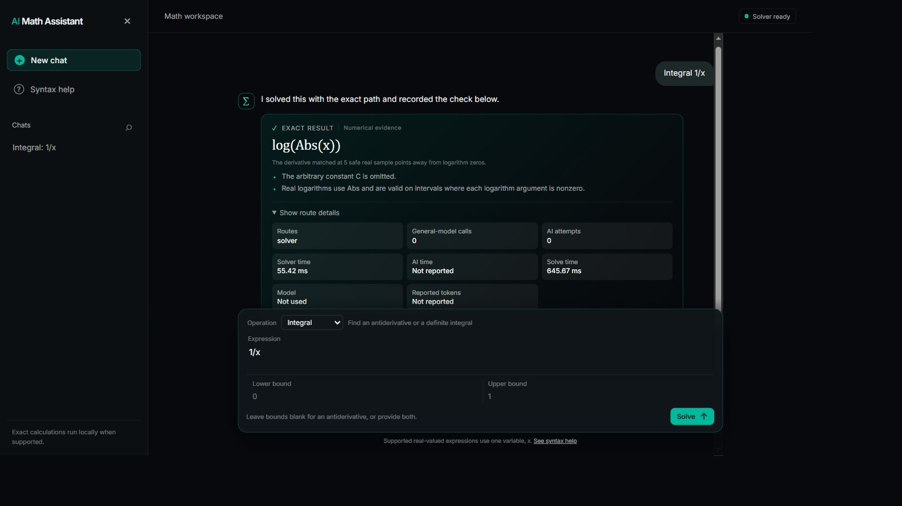

The clean-environment final gate passed 61 pytest tests, JavaScript syntax, and real HTTP smoke of all 40 frozen cases. One upstream Starlette/httpx deprecation warning remains.

## Five-run solver-only evidence

Source commit `5ec24e43221fe6148498467725e969ea9a665d75`; Python 3.14.7; i5-12400F, 6 physical cores and 12 logical processors. One production-style Uvicorn process used the locked verification environment, no reload, no provider credentials, and serial requests. Other test suites were stopped. Background desktop activity remained, so latency is a local observation rather than a controlled hardware comparison.

Across five repetitions of the unchanged 40-case set, all 150 supported solved observations were correct. All 50 boundary observations matched their expected safe behavior. There were zero failed outcomes and zero transport failures. Each repeat contained 30 solved cases, five grammar rejections, four unresolved cases, and one bounded-input refusal. These boundary cases are excluded from supported-answer accuracy.

All 200 requests recorded zero general-model calls with no unknown call counts. Provider token usage remains unreported, rather than being invented as zero. This establishes call avoidance on this fixed set only. It does not establish equal quality to a live AI baseline, token savings against a model, or a hardware-compute reduction.

Median HTTP latency over all outcomes was 585.12 ms, with observation range 515.20 to 1278.83 ms. The five per-repeat HTTP medians were 590.93, 601.46, 580.17, 569.96, 561.45 ms; their median was 580.17 ms and range 561.45 to 601.46 ms. Fast rejections contribute to this all-outcome distribution. Fresh subprocess startup and math imports are material overhead, as the separate import diagnostic shows. No AI latency comparison was run.

[Raw requests, responses, scores, counters, and environment](evidence/solver-five-runs.json). [Measurement protocol](evidence/measurement-plan.md).

## Repository completion and cleanup

The reviewed integration was directly merged into `main`, pushed, and made the GitHub default branch. All in-scope GitHub issues, including the Wayfinder map, are closed with evidence links. No PR or GitHub Actions run was created.

Managed-worktree cleanup was attempted through the Codex archive tool. The app refused to archive the solver, website, and evaluation worktrees because active tasks still reference them, and refused the review worktree as a primary checkout. These recoverable local checkouts were retained. No checkout was deleted manually. The final local server remains on port 8000; synthetic-provider services are stopped.

## Deterministic solution steps

Commit `ddfb026` adds a bounded `steps` list to every solver response that reaches the public solve contract. Solved requests describe the actual route for derivatives, indefinite and definite integrals, limits, and polynomial equations. Unresolved requests include a stopping step that names why the exact route stopped. Each list is limited to eight entries of 500 characters or fewer.

The website renders the list as an expandable **Show steps** section inside the answer card. Route metrics remain separate. AI explanations remain optional and are never used to generate these steps. The browser check submitted `x^3*sin(x)`, expanded **Show steps**, and displayed the product-rule route plus the numerical verification step. The API returned the same steps at `/api/solve`.

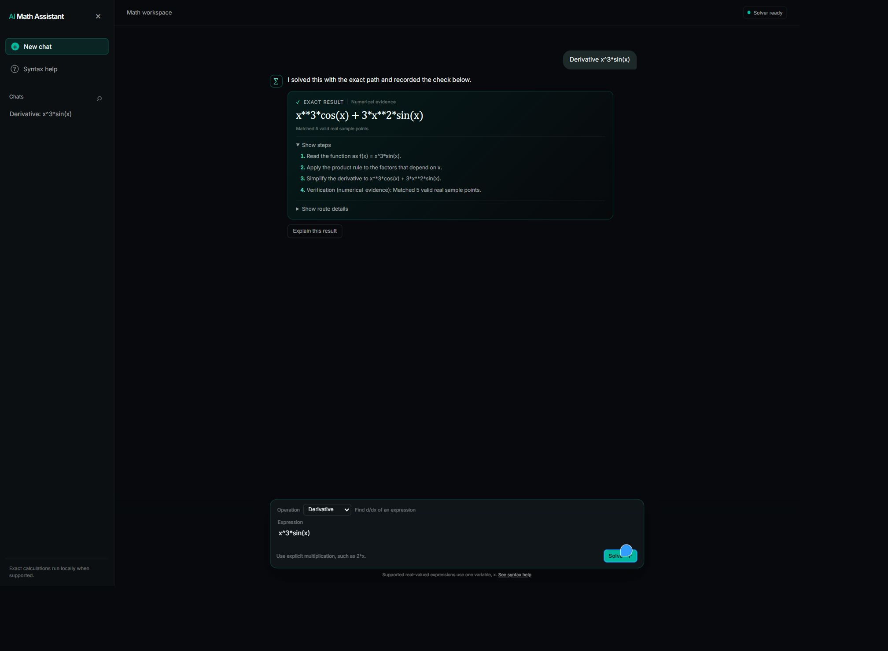

## Visual math editor validation

The composer now uses a bundled MathQuill 0.10.1-a field for the expression, integral bounds, and limit target. The MathQuill stylesheet, jQuery dependency, JavaScript build, and Symbola fonts are served locally from `web/assets`, so the editor does not depend on a CDN during the demo.

The live page was reloaded from the updated server and showed the MathQuill editable-field class on the expression control, the MathQuill stylesheet loaded, and the expected visual equation input area. The editor remains a presentation layer: the browser converts supported MathQuill LaTeX to the existing structured expression grammar before submitting `/api/solve`. The solver API and 40-case evaluation contract are unchanged.

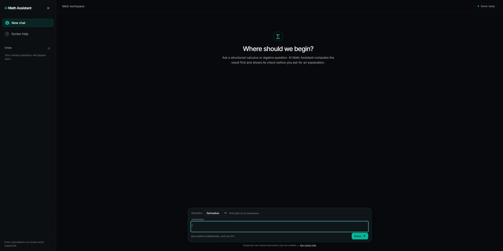

MathQuill supports visual fractions, roots, exponents, function names, and symbols. Integral and derivative workflows continue to use the existing operation selector and bound fields. The editor does not claim support for new mathematical operations, implicit variables, or arbitrary LaTeX.

## Integration-by-parts worked solutions

The exact route now shows a complete parts calculation for a linear polynomial multiplied by a sine, cosine, or exponential with a nonzero linear inner slope. Steps show `u`, `du/dx`, `dv`, the scaled primitive `v`, the parts identity, and the remaining integral before simplifying the authoritative answer. Unsupported patterns retain the existing honest generic route. No model call generates these steps, and no additional symbolic integration is introduced for the derivation.

Public API regressions cover `x*exp(x)`, `x*sin(x)`, `3*x*cos(2*x+1)`, and `(x+1)*exp(-2*x)`, plus a nonlinear inner argument that must not claim the shortcut. The local gate passed 85 Python tests, 92 frontend tests, JavaScript syntax checks, and the production-style HTTP smoke with all 40 frozen evaluation cases and zero-call routing. The known upstream Starlette/httpx deprecation warning remains.

The actual browser journey typed `x*exp(x)` into the visual editor, selected Integral, submitted, and displayed `(x - 1)*exp(x)` with seven numbered steps, a symbolic residual check, and zero model calls.

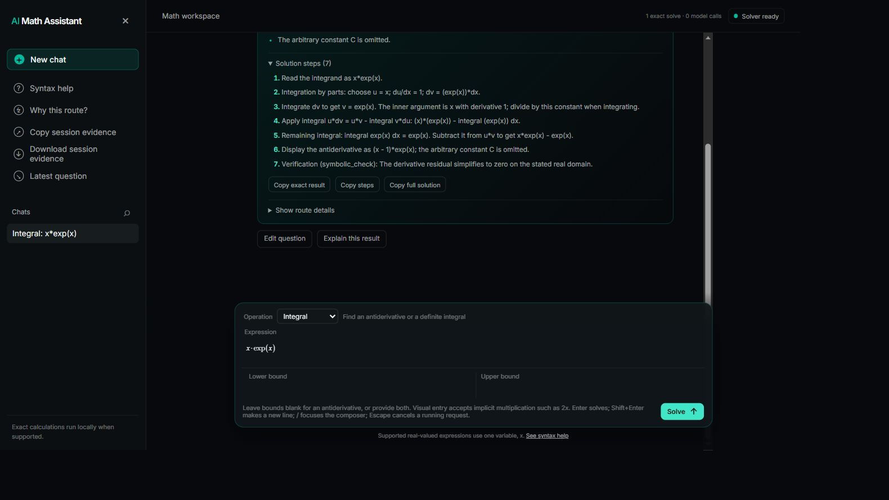

## Typeset exact answers

The result card uses the already bundled MathQuill static renderer for a conservative subset of the server's LaTeX. Fractions, ordinary square roots, powers, trigonometric functions, and finite sets are readable mathematical notation. The exact typed answer remains the accessible result and the source for copying and evidence exports. Unsupported notation and renderer failures keep readable text; AI output is never passed to this renderer.

The local gate passed 85 Python tests, 101 frontend tests, JavaScript syntax checks, and HTTP smoke including all 40 frozen evaluation cases. Public frontend checks cover accessible and copied answers, repeated rendering, missing library, renderer failure, unknown commands, indexed roots, excessive size/depth, malformed groups, and plain-language results. These tests stub the renderer and are contract checks.

Actual browser checks separately submitted the derivative of `sqrt(x+1)` and the equation `x*x-2`, confirming the grouped radical fraction and a set of radical roots. Integrating `exp(-x*x)` returned `sqrt(pi)*erf(x)/2` as readable text because its special-function notation is outside the display subset. The narrow preview had an effective CSS width of about 433 px, with no page-width overflow and the result fraction fitting inside its card. The viewport override was reset. Browser error/warning logs were empty. No live-provider evaluation or compute-reduction claim follows from these formatting checks.

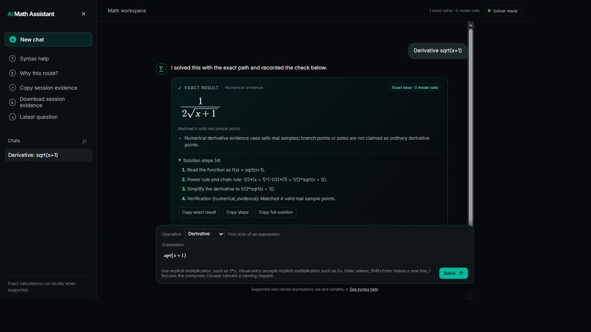

## Reading a new worked answer

New questions and completed solves now align the start of their question inside the conversation pane instead of scrolling past the answer to the bottom of a long steps list. Completion only reveals the result if the student is still following the bottom of the conversation. Someone reading earlier work keeps their scroll position. Successful, unresolved, and failed solves use the same rule.

The local gate passed 85 Python tests, 105 frontend tests, syntax checks, and all 40 frozen HTTP evaluation cases. A subsequent frontend-only correction replaced `scrollIntoView` with a conversation-local scroll calculation after the narrow browser check showed the browser moving the outer page. The latest frontend suite passed all 105 checks after that correction. New public frontend checks drive the asynchronous solve flow and cover answer reveal, preservation of an earlier reading position, unresolved results, and invalid responses.

The final live browser check submitted `x*exp(x)` repeatedly. At an effective narrow CSS width of about 433 px, the second result was above the fixed composer, the header remained at top 0, and outer page scroll stayed 0. The desktop third result also left the header at top 0 and outer scroll at 0. These checks used the final conversation-local calculation. Temporary viewport overrides were reset.

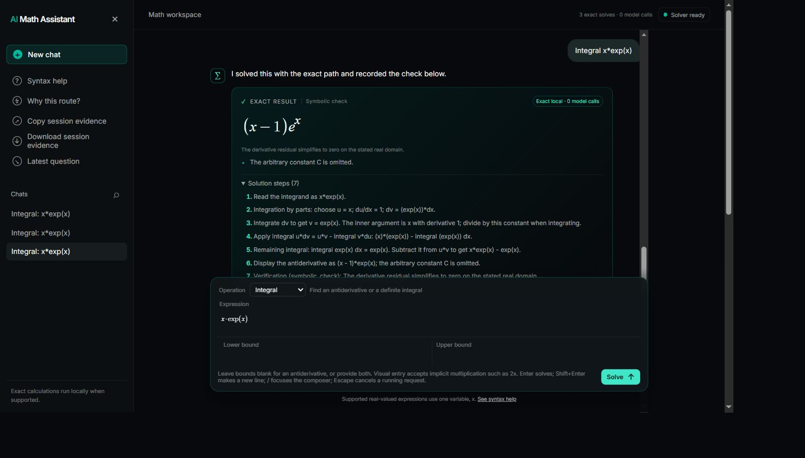

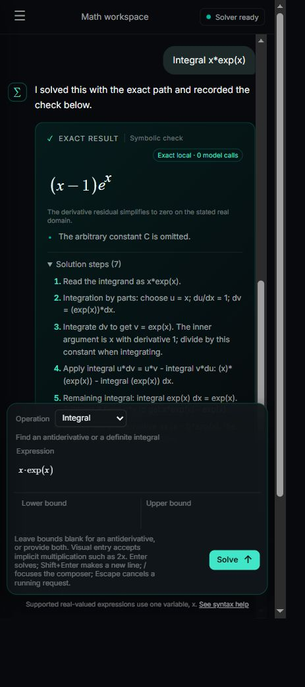

## Nonlinear substitution worked solutions

The exact route now explains substitution for a polynomial differential multiplied by `sin(g(x))`, `cos(g(x))`, or `exp(g(x))`, where the polynomial inner function has degree at least two. It calculates `g'`, checks the full constant-multiple identity, rewrites the integral in `u`, integrates using a known rule, and substitutes back. This adds no symbolic integration call, provider request, or external dependency. The authoritative answer and verification remain unchanged, with the existing eight-step and 500-character limits.

The local gate passed 87 Python tests, 105 frontend tests, syntax checks, and all 40 frozen HTTP evaluation cases. Public math API checks cover `x*exp(x^2)`, `2*x*cos(x^2+1)`, `-6*x*sin(3*x^2+2)`, and `(3*x^2+2)*exp(x^3+2*x)`. A same-degree near-match, `(2*x+1)*exp(x^2)`, must not claim the substitution because the complete differential does not match.

The browser submitted `x*exp(x*x)`, displayed `exp(x**2)/2` with seven numbered steps, a symbolic residual check, and zero model calls. After waiting for the copy-success notification, reading the clipboard confirmed all seven steps, including the scaling and substitution back. Browser error/warning logs were empty.

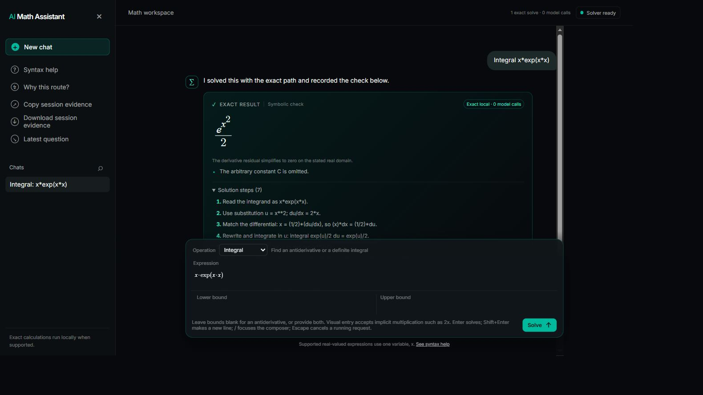

## Discoverable worked examples

The welcome screen and sidebar open a native **Worked examples** dialog. Eight presets cover the existing math operations, recognized worked methods, and two safe stopping cases. Selection restores bounds and limit direction through the shared composer path and focuses the expression without submitting. The gallery header stays visible while the list scrolls.

The local gate passed 87 Python tests, 106 frontend tests, syntax checks, and all 40 frozen HTTP evaluation cases. A frontend regression changes from a right-hand limit to a definite-integral example and verifies both bounds, cleared limit context, and no request. The browser exercised both gallery entrypoints, loaded that sequence, and submitted `x^2` from 0 to 1 to obtain `1/3` with zero model calls. Escape closed the dialog and returned focus to its opener. At an effective narrow CSS width of about 433 px, all eight choices were reachable and the close control stayed visible after scrolling. Selecting and submitting the real-domain example returned an unresolved result explaining that the square-root domain is outside the real interval, with zero model calls. The viewport override was reset.

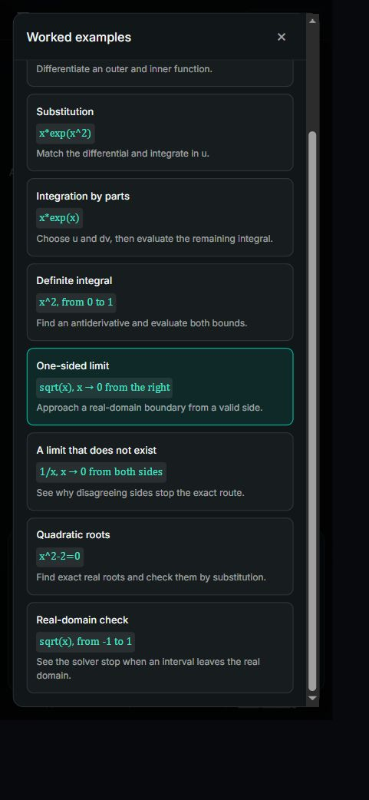

## Exact classification of real polynomial roots

The scaled cubic `x^3+1e-24*x+1e-36=0` previously returned unresolved. Its two complex roots have imaginary parts smaller than the old admission tolerance, so they entered the candidate list before the real-only sort failed. Rational-coefficient equations now use exact real-root isolation. Other coefficient domains use symbolic realness checks and stop if classification remains indeterminate. No numerical tolerance admits a root into the exact real solution set.

Familiar rational and quadratic results remain unchanged. Some irreducible cubic and quartic results now use `CRootOf` notation instead of large radical expressions. A result note explains that this is an exact indexed algebraic root, not a rounded approximation. Root substitution checks and empty-set verification labels retain their existing meaning.

The local gate passed 91 Python tests, 106 frontend tests, syntax checks, and all 40 frozen HTTP evaluation cases. An additional public API regression for `x^2-pi=0` and `x^2+pi=0` passed after the gate, bringing the verified Python tests to 92. Regressions cover the scaled cubic, tiny positive and negative discriminants, a cubic with three real roots, a quartic with two real roots, and a positive quartic with no real roots. Both reviews found no material issue.

The actual browser submitted the scaled cubic using `x*x*x+1e-24*x+1e-36=0`. It displayed one exact real root, the explanatory notation note, a symbolic substitution check, and zero model calls. Browser error/warning logs were empty.

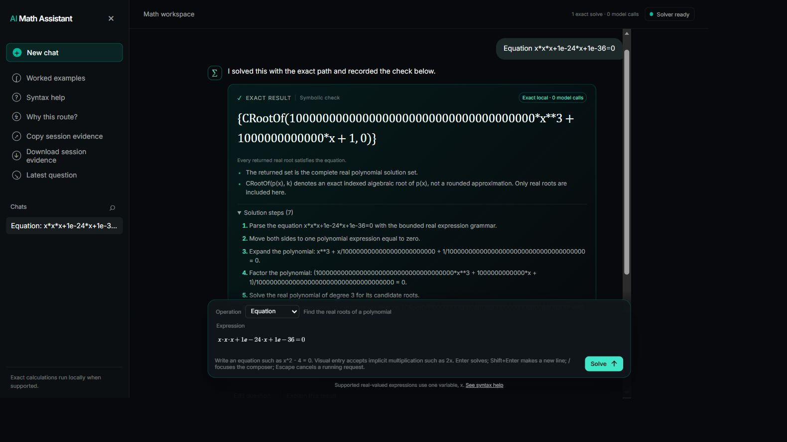

## Session evidence summary

The route dialog and evidence export now start with observed session outcomes, solved-result check types, explicit AI attempts, and reported model usage. The header uses the same calculation. Question counts reflect each question's current outcome, including its latest retry. AI call and token totals use recorded AI attempts; a missing counter on an AI attempt keeps the corresponding total unknown. Solver-only questions and solver failures do not invalidate separately reported provider usage. The summary labels its scope as session activity and makes no benchmark, live-comparison, energy, or FLOPs claim.

The local gate passed 92 Python tests, 110 frontend tests, syntax checks, and all 40 frozen HTTP evaluation cases. Review identified a missing-metrics aggregation issue; a regression reproduced it, and the corrected frontend suite passed all 110 checks. The cases cover interrupted AI usage, known usage alongside a solver failure, solver-only questions, and separation of failed checks, failed questions, and pending work. Review confirmed the fix with no further material findings.

The final browser session solved the chain-rule and substitution examples, then declined the real-domain example. The dialog displayed two solved questions, one unresolved question, one symbolic check, one numerical check, zero model calls, and unreported tokens. After the specific copy-success notification, clipboard inspection confirmed the same summary ahead of the detailed evidence. At an effective narrow CSS width of about 433 px, the dialog fit within the viewport and used two metric columns. The viewport override was reset. Browser error/warning logs were empty. No live provider was configured or invoked during these checks.

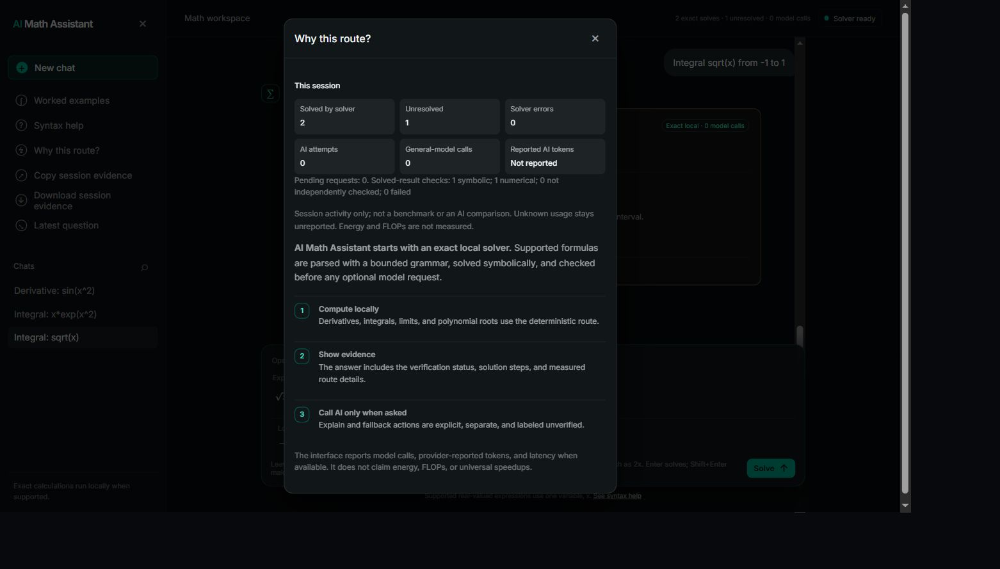

## Long formulas on narrow screens

Two grid minimum-size issues were reproduced in the browser. A long visual expression grew to about 487 px inside a 413 px composer. Its long typeset answer also expanded the message to about 781 px inside a 393 px conversation column, clipping the surrounding text. The stylesheet now permits the editor and conversation grid tracks to shrink, confines fields to their columns, and preserves local mathematical scrolling.

At an effective narrow CSS viewport of about 433 px, the corrected main editor measured about 383 px. The message matched the 393 px conversation column, while its 768 px formula scrolled inside a 313 px result area. Horizontal result scrolling left the outer page at x = 0 and y = 0. Long limit targets and integral bounds remained inside their approximately 170 px columns. Settled caret checks after Ctrl+Home and Ctrl+End placed the caret inside the field, and adding a final `+x` then submitting preserved that term in the derivative. A nested fraction retained its full 49 px math height inside a 65 px field and submitted successfully. Desktop restoration produced an approximately 814 px field inside an 850 px composer.

The existing local gate passed 92 Python tests, 110 frontend tests, syntax checks, and all 40 frozen HTTP evaluation cases. The browser geometry, editing, scrolling, and submission checks verify the layout change directly. Review found no material issue, and the additional caret and nested-fraction checks covered its remaining concerns.

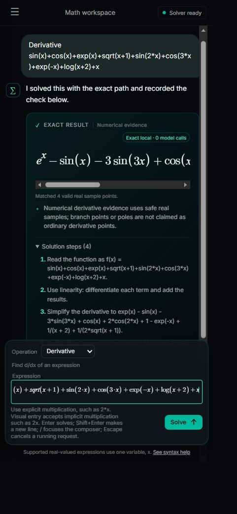

## AI attempt history, pending browser verification

The local change preserves earlier AI attempts in a collapsible section after a retry, keeps their answers labeled unverified, and provides a copy action for each earlier answer. The expanded-history choice survives rerendering. Route details now say that model metadata is unreported when an attempted call has unknown usage, rather than claiming no model was used.

The local gate passed 92 Python tests, 111 frontend tests, syntax checks, and all 40 frozen HTTP evaluation cases. The new public frontend regression reproduces a successful explanation followed by a failed retry, confirms the earlier text remains available and copyable, preserves the expanded state, checks its unverified labeling and model metadata, and confirms history access makes no request.

`scripts/preview_ai_contract.py` starts a localhost-only app with a synthetic external transport: the first provider attempt returns clearly labeled fixture text and fixture token counts, and later attempts fail. The script started successfully and its help command passed. No real provider was contacted. The intended browser journey has not been verified: the prior browser-control runtime was unavailable, and the Windows computer-use fallback stopped because it could not confidently determine the current Chrome URL. This change remains local and unpublished pending that check.

## Reusing exact results

Solved cards now expose **Copy LaTeX** when the server's LaTeX result differs from the typed result. **Copy exact result** remains the authoritative structured string used by the API and evidence. A frontend contract test checks both clipboard values and their labels, and confirms the feature is absent when no distinct LaTeX form exists. The full local gate passed 92 Python tests, 112 frontend tests, JavaScript checks, and all 40 frozen HTTP evaluation cases. Browser verification of this small card action remains pending because the browser-control runtime is unavailable in this turn.
