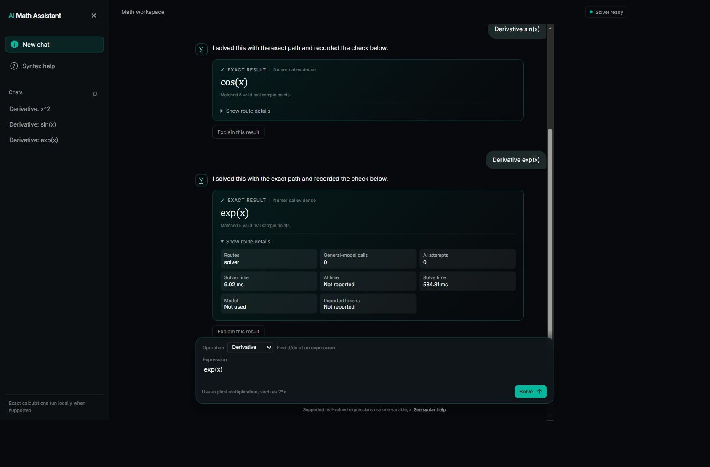
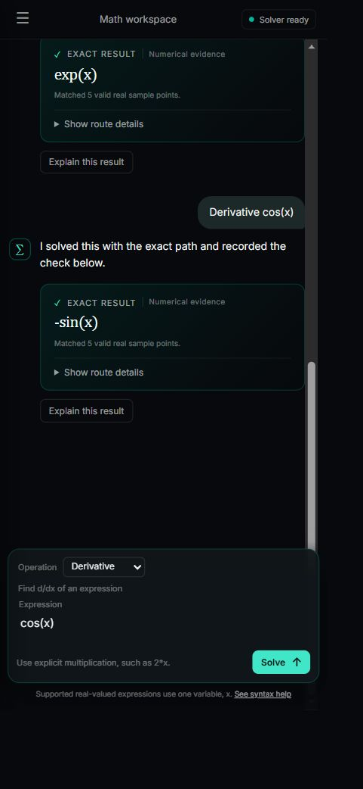
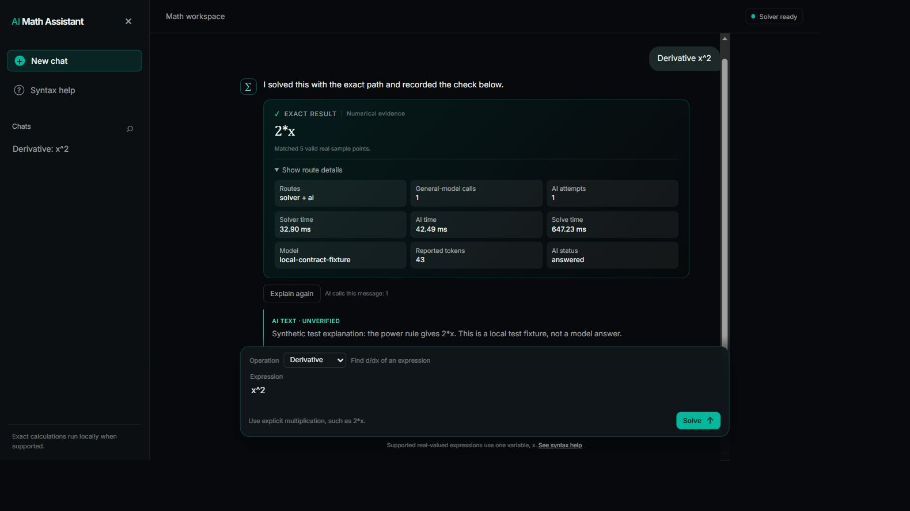
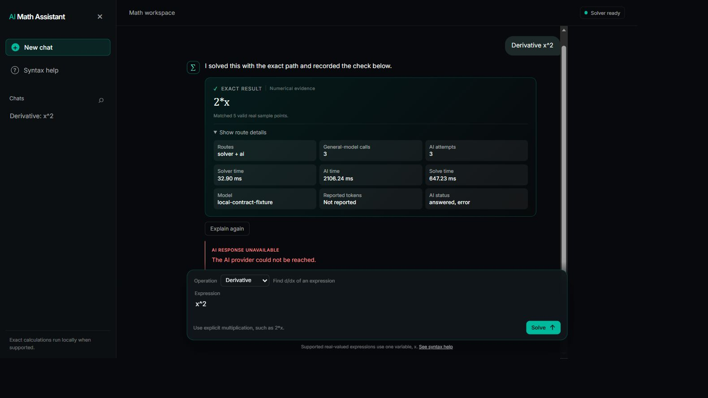

# Local delivery validation

## Scope and evidence

The implementation is a working local website, not the earlier static visual prototype. It covers structured single-variable derivatives, integrals, limits, and bounded polynomial equations. The default solve route never requests an explanation or model fallback automatically.

The user approved the layout and public API and browser test boundaries before implementation. Local checks precede direct merges. No PRs or GitHub Actions are used.

## Browser journey

The actual website at `http://127.0.0.1:8000` was exercised through the in-app browser on 29 October 2026:

- Enter submitted `x^3*sin(x)` and displayed the product-rule derivative with a numerical-evidence label.
- A definite integral of `x^2` from 0 to 1 returned `1/3` with a quadrature check.
- The two-sided limit of `sin(x)/x` at zero returned `1`.
- The equation `x^2-4=0` returned `{-2, 2}` with root-substitution details.
- An unsupported function produced a useful validation message while the solver stayed ready.
- Syntax help opened, displayed the allowlist, and closed with Escape.
- Session question search filtered the sidebar, and New chat cleared the session.
- The selected chat row is highlighted and exposed as the current item to assistive technology; Latest question returns focus to the newest result.
- Desktop sidebar collapse and reopen worked.
- Repeated submissions exposed an unbounded conversation layout. The final shell uses a viewport height and an internal scroll area. After the fix, the newest result remained visible above the composer on wide and narrow viewports.
- A narrow viewport displayed a real derivative result without horizontal page overflow in the captured view.
- Browser console inspection during these journeys returned no errors or warnings.
- The current UI also exposes the exact-first rationale, a visible general-model call count, inline validation for incomplete bounds or targets, copy actions for the result and full solution, and cancel/retry controls for slow solver or optional AI requests.
- A repeated-question browser journey keeps duplicate sidebar entries addressable, and a cancelled solve returns to a ready service state with the original question available for retry.
- The top-bar session scorecard reports solved exact routes and provider calls, excluding unresolved requests from the solved count. Syntax-help examples can be clicked to populate the composer, including a limit target.
- Each deterministic solution section displays its bounded step count while keeping the full numbered derivation visible.
- The sidebar's Copy session evidence and Download session evidence actions package the current session's statuses, results, verification details, route call counts, timings, optional unverified AI text, and every numbered solution step for review.
- A solved answer's full-solution copy preserves the same route proof and any answered AI explanations, even when a later AI retry fails.
- Safely unresolved requests expose a Copy full attempt action that preserves the question, stop reason, verification state, and steps without inventing a result.
- When an exact route stops safely, the scorecard reports the unresolved count separately instead of presenting it as a solve.
- Escape cancels an active solver or optional AI request while preserving the retry path; dialog Escape behavior remains unchanged.
- Optional AI loading and answered states expose busy and polite live-region semantics for assistive technology.
- The browser rejects solver payloads with missing, empty, oversized, or excessive derivation steps and leaves the question retryable instead of rendering partial evidence.
- Solver responses are also checked against the submitted operation and expression, preventing stale or mismatched answers from being displayed.
- Health responses must contain the expected ready status and boolean AI configuration flag before the UI reports service readiness.
- Successful AI payloads must carry explicit `not_checked` verification metadata before their text is rendered as an unverified explanation.
- Result-card copy actions expose distinct accessible labels for the exact result, all derivation steps, and the complete verified or unresolved attempt.
- Escape closes an open chat search and clears its filter before request cancellation is considered.
- Exact formulas expose a semantic status role and an accessible label containing the computed result.
- Verification icons are decorative and hidden from assistive technology while the adjacent status text remains available.
- The composer hint documents Enter to solve, Shift+Enter for a new line, and Escape to cancel an active request.

The wide and narrow viewport controls were set to 1366 by 900 and 390 by 844 respectively. Browser zoom and screenshot pixel scaling can make captured pixel dimensions differ from those requested values.

## Evaluation protocol

The frozen fixture file has SHA-256 `EE15FF9C9E6733C99FB09B8BD96CF9E5746516059582AECD34EF4BC06D321DF2`. It contains 30 supported solved cases and ten boundary cases, for a total of 40. Expected answers are worked literals. A check using SymPy does not constitute an independent implementation of the same mathematics.

The first public HTTP run exposed three protocol mismatches. The scorer did not equate an empty real root set with the no-real-solutions sentinel, a resource-limit rejection did not match the bounded-input policy, and a disagreement between one-sided limits returned a solved result with a failed-check label. The scorer and result contract were corrected, with regression tests. The mathematical fixture answers were not changed after that run. The bounded-input scoring rule accepts a safe 422 response or an unresolved response. Neither counts as a solved answer.

## Optional AI browser contract

An isolated app on local port 8001 used a synthetic HTTP provider on port 9001 with model name `local-contract-fixture`. The response itself said it was a local fixture rather than a model answer. The main app on port 8000 was not connected to that fixture.

The browser solved `x^2` as `2*x`, then Explain preserved that exact answer and displayed `AI text · unverified`. The route showed one attempt and 43 synthetic tokens. An explicit Explain again action accumulated two attempts and 86 synthetic tokens. After the fixture provider stopped, another explicit attempt produced a redacted connection error, preserved `2*x`, counted three attempts, and marked total token usage unreported. Both temporary services were stopped after the check.

These screenshots verify UI integration and accounting only. Their response text, timing, and token counts are synthetic test values and are excluded from efficiency evidence.

## Latest solver-only measurement

On 30 October 2026, three repeats of the 40-case public HTTP benchmark produced 120 observations. All 90 supported-case observations were correct, all 30 boundary observations passed, failed outcomes were zero, and the exact route recorded zero general-model calls. Client wall-clock latency had a 576.7 ms median, with a 527.2 to 767.9 ms range. The bounded SymPy worker had a 39.1 ms median across completed solved cases.

These timings include local process and HTTP overhead and are evidence about this route on this PC. They are not an AI latency comparison and do not measure energy, FLOPs, or total compute.

## Limits

Provider contract tests use a fake external HTTP transport and make no paid model calls. They validate requests, grounding, usage accounting, and failure handling. They do not establish live model quality, provider compatibility, token savings, or model inference latency.

No API key or external hosting configuration was supplied. Live provider comparison and external publication remain pending user-owned configuration. The local solver remains usable without them. The repository provides `.env.example`, a Dockerfile, and a manual HTTPS deployment guide. Docker is unavailable on this PC, so a container build has not been verified here.

No energy, FLOP, GPU-power, or total cloud-compute measurement is claimed.
